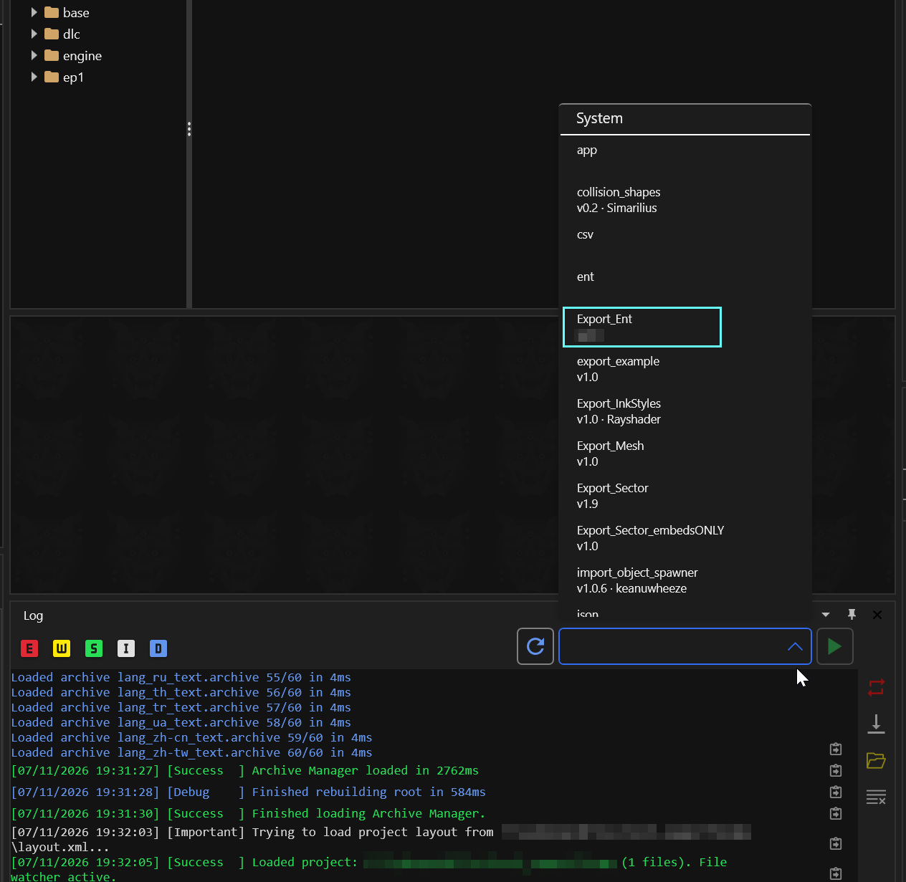
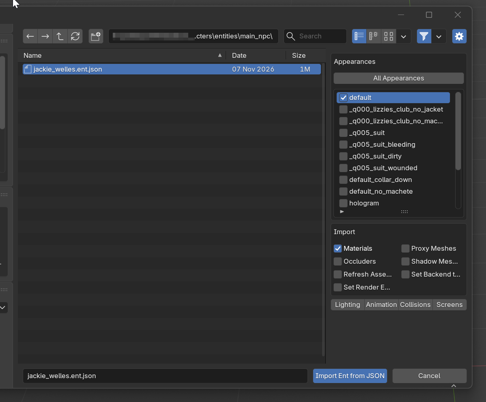

# Exporting Game Entnties to Blender

## Summary

**Created by** [Simarilius](https://app.gitbook.com/u/G2MqNkfgTlQ1R3G4B5s6WefLjdy2 "mention") **&** [dragonzkiller](https://app.gitbook.com/u/dpriBUirXwWYeCIhyywmqhKrMMV2 "mention")\
**Published: September 03 2022**\
**Last documented update: November 2026**

This guide aims to walk you through finding and exporting something from the game to Blender so that its usable for cosplay, 3d printing, or whatever.&#x20;

#### This guide uses the following versions:

Cyberpunk 2077: 2.5



## Prerequisites

* [ ] You have [created a new Wolvenkit project](../../wolvenkit-app/usage/wolvenkit-projects.md#create-a-new-wolvenkit-mod-project)


This guide works just the same for guns or vehicles — add the .ent to your project, run the script, import, profit.&#x20;

If you want to add a character's animations, you can check the follow-up guide [exporting-rigs-and-anims.md](exporting-to-blender/exporting-rigs-and-anims.md "mention").


## The .ent file

This section will tell you how to find and add an .ent file to your project. \
If you already have one (because you're exporting an NPV), you can skip it and go straight to [#exporting-to-blender](exporting-to-blender.md#exporting-to-blender "mention").

### What's this for?

The .ent file is the game's top level definition of anything - a character, a vehicle, a weapon.&#x20;

### Finding the file

Before we can export anything, we need to find the `.ent` file for the thing we want to export. This tutorial will use Jackie, but it works just the same for everyone else.


You can find lists of the most common files on the yellow wiki:

* [NPCs and their files](https://app.gitbook.com/s/4gzcGtLrr90pVjAWVdTc/for-mod-creators-theory/references-lists-and-overviews/people "mention")
* [Cheat Sheet: Vehicles](https://app.gitbook.com/s/4gzcGtLrr90pVjAWVdTc/for-mod-creators-theory/references-lists-and-overviews/vehicles/vehicles "mention")
* [Weapons](https://app.gitbook.com/s/4gzcGtLrr90pVjAWVdTc/for-mod-creators-theory/references-lists-and-overviews/cheat-sheet-tweak-ids/weapons "mention")


The easiest way to find a characters ent if their not already in the list on the wiki is to use Red Hot Tools. Once its installed you can simply walk up to an NPC in game and the inspect tab will show you the ent and appearance info you need. With that info you need to find them in wolvenkit.

<figure><figcaption></figcaption></figure>

With our project open in Wolvenkit, we switch to the [Asset Browser](../../wolvenkit-app/editor/asset-browser.md) and use the [search](../../wolvenkit-app/usage/wolvenkit-search-finding-files.md) to find the right file:

```
jackie > .ent
```

This will give us plenty of files — we'll sort them by file extension and scroll to the `ent` section of the list. `jackie_welles.ent` looks promising, so we'll double-check if it's the right file:&#x20;

* Right-click it and select `Open without adding to project`
* Use the `entity preview` tab to confirm that it's him

<figure><figcaption></figcaption></figure>

Now, [add the file to your project](../../wolvenkit-app/editor/asset-browser.md#adding-files-to-projects).

## Exporting to Blender

With the `.ent` file in your project, you can run the script that will handle the actual export, adding all the necessary files to your project and exporting them in a way that Blender can process:

<figure><figcaption><p>You can also run this from the  <a data-mention href="../../wolvenkit-app/tools/script-manager.md">script-manager.md</a>  </p></figcaption></figure>

Afterwards, click the play button.


<details>

<summary>What does the script do/how to do it by hand? (You don't need to know this)</summary>

If you open the Entity file then expand the appearances bit of the entity template, he has 15 appearances which all appear to be defined in jackie\_welles.app. For this next step you need to have the Wolvenkit resources plugin installed (View Options > plugins to install). The app should also be in the search results for jackie, simply right click it, then do find used files. Sort by type again and find the cookedapp files. Theres several which cover the different appearances, for each one you want to include in your export do the following:&#x20;

* Right click, do Find used files&#x20;
* Sort by type, find the mesh files&#x20;
* Select all and right click, add selected to project

You may need to go through the app file afterwards to check all the meshes got found, it sometimes seems to miss some.

The mesh files should now be visible in the project explorer, occasionally I find they arent showing up but closing and reopening the project makes them appear.

Open the Export Tool, and verify your meshes are listed. Double click one then the export options opens, and verify WithMaterials as the export type and LOD Filter is on. Set the texture type to png if it is not. Select Apply to all files of the same extension then confirm.&#x20;


Now select Export All (or Export Selected) on the menu bar and a bunch of glb and json files should be exported. After its done a files have been exported notification should pop up to notify you of the success.&#x20;

</details>


After the script has successfully run, you will find an `.ent.json` file in your project's [raw folder.](../../wolvenkit-app/editor/project-explorer.md#raw)


## Importing into Blender


If you right-click the `.ent` file in the project browser and press `Shift` and `Ctrl`, the context menu will let you copy the path to the file!


Switch to Blender and use the [Wolvenkit Blender IO Suite](https://app.gitbook.com/s/4gzcGtLrr90pVjAWVdTc/for-mod-creators-theory/modding-tools/wolvenkit-blender-io-suite "mention")'s [Entity Import](https://app.gitbook.com/s/4gzcGtLrr90pVjAWVdTc/for-mod-creators-theory/modding-tools/wolvenkit-blender-io-suite/wkit-blender-plugin-import-export#importing-into-blender-2) from the File -> Import menu.&#x20;


Before clicking the import button, please read the next section about [#importing-a-specific-appearance](exporting-to-blender.md#importing-a-specific-appearance "mention").



Find the full documentation on the yellow wiki under  [Wolvenkit Blender IO Suite](https://app.gitbook.com/s/4gzcGtLrr90pVjAWVdTc/for-mod-creators-theory/modding-tools/wolvenkit-blender-io-suite "mention") -> [WKit Blender Plugin: Import/Export](https://app.gitbook.com/s/4gzcGtLrr90pVjAWVdTc/for-mod-creators-theory/modding-tools/wolvenkit-blender-io-suite/wkit-blender-plugin-import-export "mention") ->  [WKit Blender Plugin: Import/Export #Entities](https://app.gitbook.com/s/4gzcGtLrr90pVjAWVdTc/for-mod-creators-theory/modding-tools/wolvenkit-blender-io-suite/wkit-blender-plugin-import-export#entities "mention")


Point it to the exported `.ent.json` in your project's files (if you right-click the .ent in your project and hold `ctrl`+`shift`, then the context menu will let you copy the absolute path to the raw folder):<br>

<figure><figcaption></figcaption></figure>


Blender might need a few minutes to load the materials and bake the shaders. If you aren't getting any errors, just assume that it's still at it.&#x20;

To double-check, you can select Window -> Toggle System Console to watch Blender work, but you have to do that BEFORE you click the button.


Now, click the `Import Ent from JSON` button and wait while the Blender plugin does its thing.&#x20;

<figure><figcaption></figcaption></figure>
