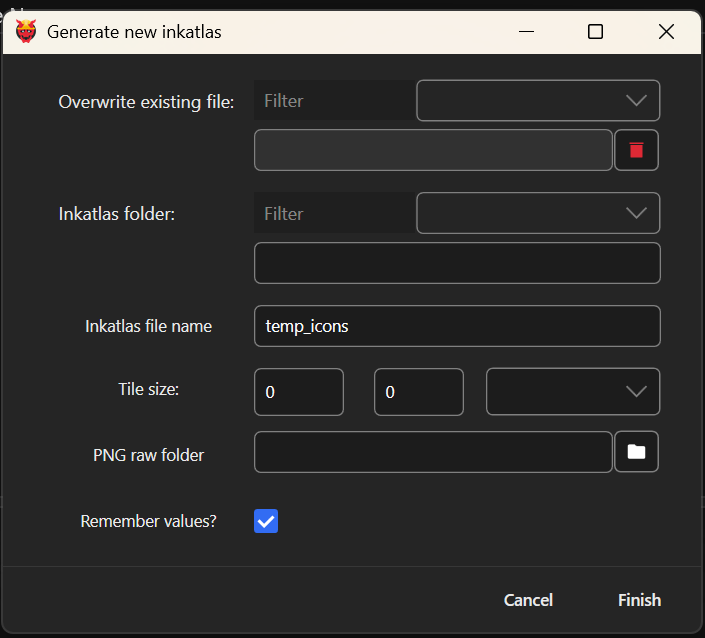

# Inkatlas generator

**Created:** Oct 25 2026 by [mana vortex](https://app.gitbook.com/u/NfZBoxGegfUqB33J9HXuCs6PVaC3 "mention")\
**Last documented update:** Oct 25 2026 by [mana vortex](https://app.gitbook.com/u/NfZBoxGegfUqB33J9HXuCs6PVaC3 "mention")

This page describes the Wolvenkit inkatlas generator (menu entry: `File` -> `Generate files` -> `Icon file (inkatlas)` ).&#x20;

### Wait, this is not what I want!

For a guide on creating icons, see the [yellow wiki](https://app.gitbook.com/s/4gzcGtLrr90pVjAWVdTc/modding-guides/custom-icons-and-ui/adding-items-preview-images).&#x20;

## Screenshot

<figure><figcaption></figcaption></figure>

## Overwrite existing file

You can pick an existing .inkatlas file from the dropdown menu. This will populate both the [#inkatlas-folder](inkatlas-generator.md#inkatlas-folder "mention") and [#inkatlas-file-name](inkatlas-generator.md#inkatlas-file-name "mention") input boxes.

## Inkatlas folder

Relative path to the folder under `archive` where you want your file to be created, e.g. `tutorial\my_custom_shirt\icons`

## Inkatlas file name

The file name (you don't need to put `.inkatlas`). This will be appended to the [#inkatlas-folder](inkatlas-generator.md#inkatlas-folder "mention").

## Tile Size

The size for the individual icons in your .inkatlas. You can select a preset from the dropdown.

## PNG raw folder

The folder with your icon images. Inkatlas fields will be named after the .png file name.

Example:

```
red.png                    =>    red
blue.png                   =>    blue
green.png                  =>    green
i_love_long_filenames.png  =>    i_love_long_filenames
```
