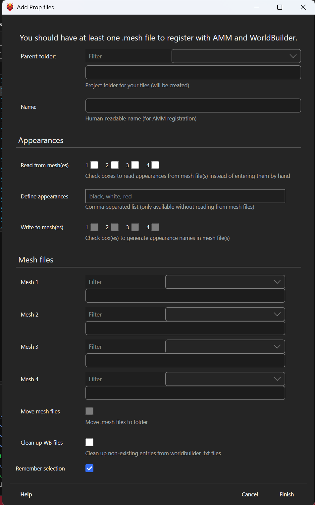

# Prop generator

**Created:** Jul 4 2026 by [mana vortex](https://app.gitbook.com/u/NfZBoxGegfUqB33J9HXuCs6PVaC3 "mention")\
**Last documented update:** Jul 4 2026 by [mana vortex](https://app.gitbook.com/u/NfZBoxGegfUqB33J9HXuCs6PVaC3 "mention")

This page describes the Wolvenkit prop generator (menu entry: `File` -> `Generate files` -> `Prop (decoration)` )

<figure><figcaption></figcaption></figure>

## Parent folder

The folder in which you want your files to be stored.

#### Use existing folder

By selecting an existing folder from the dropdown, [#name](prop-generator.md#name "mention") will be populated automatically.

#### Create new folder

You can enter a folder path in the textbox. Folders that do not exist will be created.

## Name

Human-readable name of your prop. This will only be used for AMM.

## Appearances

Your prop can have one or many appearances.&#x20;

### Read from meshes

Instead of defining the appearances here, you can read them from your prop's meshes.


Use this if you have a mesh with existing appearances that you want to spawn


### Define appearances

A comma-separated list of appearances. They will be registered in AMM, and created across the control files.

### Write to mesh(es)

Only available if you have defined appearances: if your .mesh files do not have them, then they will be created by duplicating and re-naming an existing appearance.

## Mesh files

Select up to four project files to add to this prop


Why only four entries? Because AMM's scaling feature only supports that many, and because I didn't want to implement a dynamic UI with unlimited entries.


## Move mesh files

If your mesh files are not in the [#parent-folder](prop-generator.md#parent-folder "mention"), checking this box will put them there.

## Clean up WB files

This will remove non-existing entries from the WorldBuilder registry files. Useful if you have deleted or renamed props in an existing project.

## Remember selection

The dialogue will not start up empty next time, but remember some of your settings. Handy when creating e.g. multiple props in the same subfolder.
